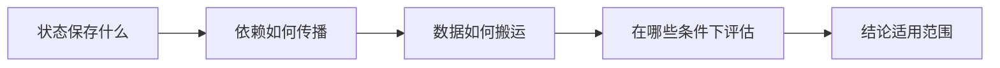

## 综合观点

阅读效率架构时，可以依次核对状态、计算依赖、数据移动和评估条件。这个组织方式是 AI 对所列来源的综合，不是任一论文提出的通用定理。

## 四个检查点

1. 状态是逐 token 的 [[kv-cache|KV cache]]、递归状态，还是由参数表保存的知识表示。
2. 依赖是否改变了 [[computation-graph|计算图]] 的深度与并行性。
3. 减少运算是否同时减少访存；用 [[arithmetic-intensity|算术强度]] 区分两个问题。
4. 平均指标是否掩盖位置、对话轮数或任务条件的差异。

Engram 的参数查询、KDA 的状态更新与 Recurrent Transformer 的层内循环解决不同问题。Periodic Weak Spots 与多轮对话研究提醒读者：改变输入组织方式也可能改变可靠性。

## 使用边界

这里只整理研究阅读顺序，没有生成用户提问、理解判断或新实验结果。每项结论应回到来源中的模型、版本、数据和测量条件。

## 来源定位

s1–s3：对应论文摘要与方法概要。s4：第1–2页的相位分析动机。s5：摘要与多轮评估方法。
